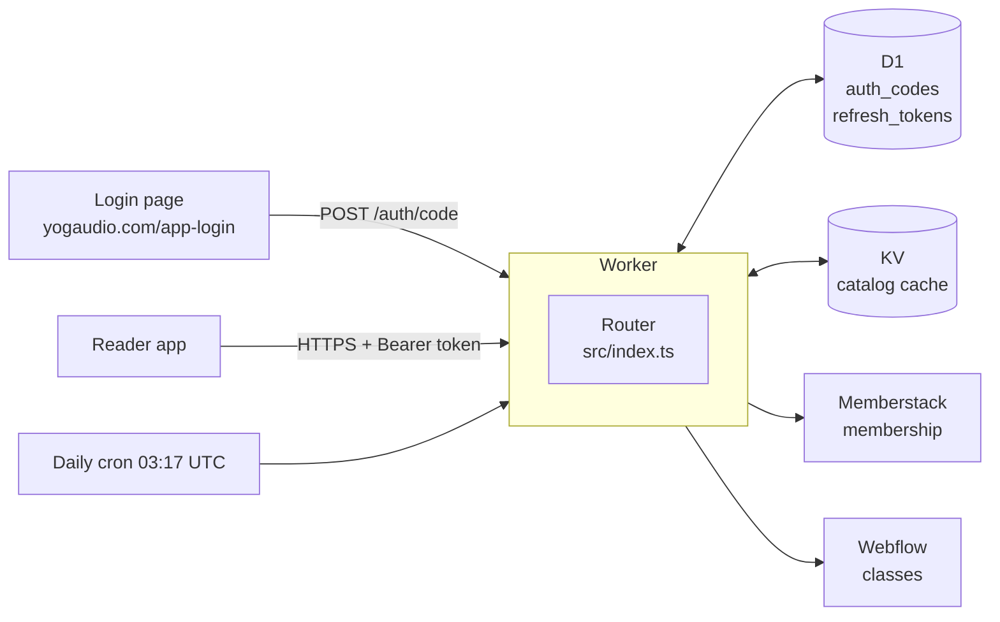
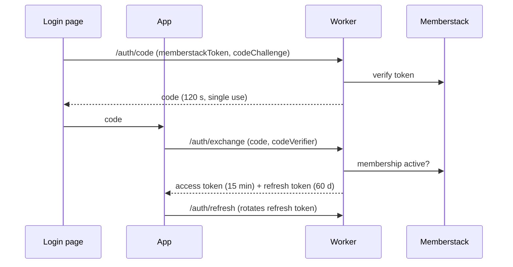
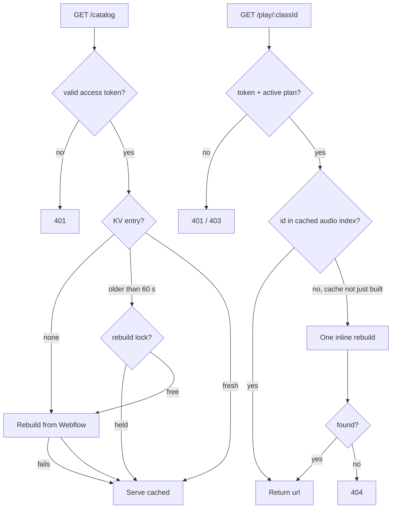

# yogaudio-api: overview

Cloudflare Worker (TypeScript, no framework) behind the yogaudio reader app. Checks Memberstack membership, issues tokens, serves the Webflow class catalog, and hands out audio URLs to active members only.

Setup, config and deploy: see [README](../README.md).

## System

## Routes

| Route | Auth | Purpose |
|---|---|---|
| `GET /health` | none | liveness |
| `POST /auth/code` | Memberstack token | one-time code (rate limited, CORS) |
| `POST /auth/exchange` | code + PKCE verifier | access + refresh tokens |
| `POST /auth/refresh` | refresh token | rotate tokens |
| `POST /auth/logout` | refresh token | revoke token |
| `POST /account/delete` | access token | delete member in Memberstack, clear local data |
| `GET /catalog` | access token | class list (ETag) |
| `GET /play/:classId` | access token + active plan | audio URL |

## Sign-in (PKCE)

Reusing a rotated or revoked refresh token revokes all of that member's tokens.

## Catalog and play

## Source map

| File | Role |
|---|---|
| `src/index.ts` | router, CORS, cron entry |
| `src/auth.ts` | code, exchange, refresh, logout, cleanup |
| `src/tokens.ts` | access JWT, PKCE, hashing |
| `src/memberstack.ts` | verify token, membership check |
| `src/catalog.ts` / `src/webflow.ts` | Webflow fetch, normalize, KV cache |
| `src/audio.ts` | `/play` |
| `src/account.ts` | account deletion |
| `src/upstream.ts` | upstream calls; timeouts and 5xx become 502 |
| `dev/` | fake Memberstack/Webflow servers for local dev |

## Known limit

`/play` returns a public Transistor URL (`expiresAt: null`). The membership check gates who gets it; the URL itself does not expire.
